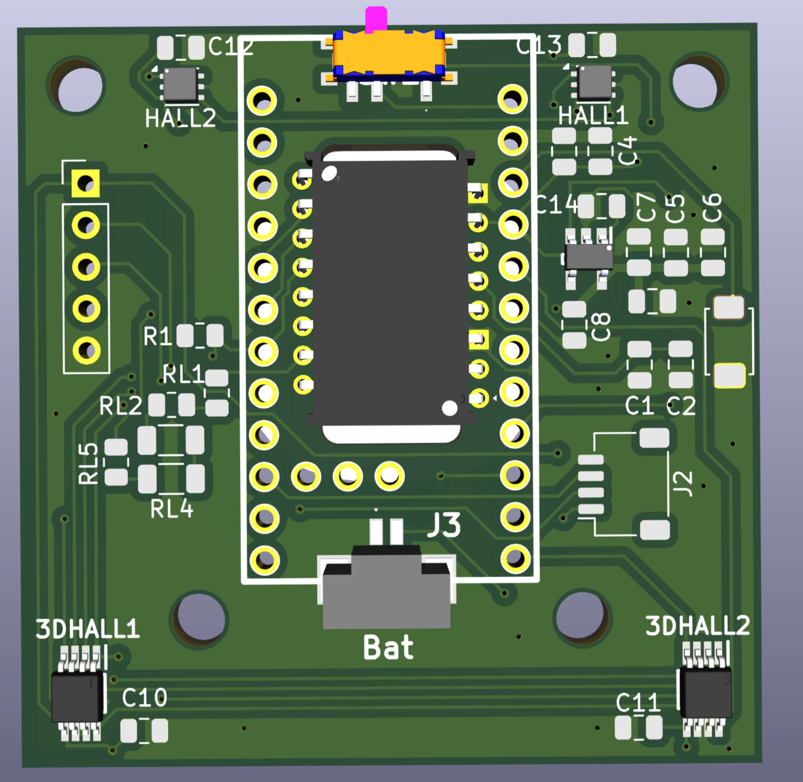

# Open Source Wireless Mouse

A custom, high-performance wireless mouse project featuring custom PCB design, high-end optical sensors, and Hall effect switches. This repository contains all hardware schematics, PCB layouts, and firmware source code required to build the mouse from scratch. 

> ⚠️ **WORK IN PROGRESS (WIP) / UNTESTED HARDWARE** ⚠️  
> This project is currently in active development. The custom PCB design and firmware have **not yet been physically tested or manufactured**. The files are provided as-is. Build at your own risk!



## Project Overview

This project is built around the popular Nice!Nano (nRF52840) footprint and uses a combination of modern frameworks like Zephyr for the firmware. The hardware design is fully documented in KiCad and utilizes magnetic Hall effect sensors for durable, debounce-free clicking.

### Key Features

* **Custom KiCad PCB**: Fully routed custom board (`mouse.kicad_pcb`) with production-ready Gerber/BOM files.
* **High-End Optical Sensor**: Utilizes the PAW3395 mouse sensor.
* **Magnetic Switches**: Implements the TLE493DP2B6A2HTSA1 Hall effect sensor for primary buttons.
* **Multi-Environment Firmware**: Codebase includes implementations in Zephyr RTOS.


---

## 🛠️ Hardware & Bill of Materials (BOM)

The hardware relies on readily available components. Below is the core BOM based on the current design:

| Component | Description | Estimated Cost |
| --- | --- | --- |
| **PAW3395** | Primary Mouse Sensor | 10.00€ |
| **TLE493DP2B6A2HTSA1** | Hall Effect Sensor (Switches) | 2.59€ |
| **LDO Regulator** | Power Management | 0.753€ |
| **Nice!Nano** | nRF52840 Microcontroller Board | - |
| **TMAG5170A2QDGKR** | Alternative Magnetic Sensor | - |
| **SSSS811101** | Power Switch | - |

> **Note on Power:** The 2V LDO regulator is required for stable sensor operation and is currently sourced via Mouser, as it is difficult to find on AliExpress.


---

## 📂 Repository Structure

```text
.
├── Code/
│   ├── nrf/                  # Rust-based firmware using nrf-hal (blinky, pwm, i2s, usb)
│   ├── PMW3389DM-master/     # Arduino polling/interrupt examples for the sensor
│   └── zephyr/               # Zephyr RTOS implementation and board overlays
├── Img/                      # Project images and renders (e.g., PCBFront.png)
└── PCB/
    ├── Components/           # Custom KiCad footprints and symbols (.step, .kicad_mod)
    ├── production/           # Manufacturing files (BOM, positions, netlist, zip)
    └── mouse.kicad_pro       # Main KiCad project file

```

---

## 💻 Firmware & Software

This repository offers multiple paths for firmware development depending on your preferred tech stack:

1. **Rust (`Code/nrf`)**: Bare-metal Rust implementation utilizing `embassy` or `nrf-hal` for maximum memory safety and low power consumption (NOT TESTED).
2. **Zephyr RTOS (`Code/zephyr`)**: Includes board overlays (e.g., `nrf52840dk`, `esp32c3`) and HID peripheral configurations for scalable RTOS development (NOT TESTED).
3. **Arduino / ESP32 (`Code/PMW3389DM-master`)**: For rapid prototyping, utilizing the standard ESP32 BLE Mouse library.


### Building the Firmware (Rust)

Navigate to the `Code/nrf` directory and use Cargo to build the project for the `thumbv7em-none-eabi` target:

```bash
cd Code/nrf
cargo build --release

```

---

## 🏭 Manufacturing the PCB

All necessary files to order the PCB from fabricators (like JLCPCB or PCBWay) are located in the `PCB/production/` folder.

* **`mouse.zip`**: Contains the Gerber files.
* **`bom.csv`**: Bill of Materials for SMT assembly.
* **`positions.csv`**: CPL/Pick-and-place files.